# Завдання 3. Граф знань для рекомендаційної системи
 
У цій роботі я завантажила датасет фільмів і оцінок у Neo4j та написала різні Cypher-запити: від простих фільтрів до пошуку схожих користувачів і найкоротших шляхів.
 
Датасет: [MovieLens 1M](https://grouplens.org/datasets/movielens/1m/) (6 040 користувачів, 3 883 фільми, 1 000 209 оцінок від 1 до 5).
 
## Як запустити
 
1) Покласти файли `movies.dat`, `ratings.dat`, `users.dat` у корінь проєкту і запустити конвертацію у CSV:
```bash
python3 convert.py
```
 
2) Підняти базу через Docker:
```bash
docker-compose up -d
```
 
3) Відкрити http://localhost:7474 (логін `neo4j`, пароль `password123`).
4) По черзі виконати запити з файлів `queries/part2_load.cypher`, `queries/part3.cypher`, `queries/part4_supernodes.cypher`.
## Структура репозиторію
 
```
.
├── docker-compose.yml
├── convert.py
├── import/                     # CSV після конвертації
│   ├── movies.csv
│   ├── users.csv
│   └── ratings.csv
├── queries/
│   ├── part2_load.cypher
│   ├── part3.cypher
│   └── part4_supernodes.cypher
├── screenshots/
└── README.md
```
 
## Частина 1. Схема графа
 
### Схема
 
```
   ┌─────────────────────────┐
   │          User           │   користувач
   │  userId                 │
   │  gender     (стать)     │
   │  age        (вік)       │
   │  occupation (професія)  │
   └────────────┬────────────┘
                │
                │  RATED { rating, timestamp }
                │  "користувач оцінив фільм"
                ▼
   ┌─────────────────────────┐
   │          Movie          │   фільм
   │  movieId                │
   │  title      (назва)     │
   │  year       (рік)       │
   └────────────┬────────────┘
                │
                │  HAS_GENRE
                │  "фільм має жанр"
                ▼
   ┌─────────────────────────┐
   │          Genre          │   жанр
   │  name                   │
   └─────────────────────────┘
```
 
Коротко:
 
```
(User {userId, gender, age, occupation})
(Movie {movieId, title, year})
(Genre {name})
 
(User)-[:RATED {rating, timestamp}]->(Movie)
(Movie)-[:HAS_GENRE]->(Genre)
```
 
Я взяла за основу модель з підказки до завдання, бо вона добре підходить під ці дані.
 
Так схему намалював сам Neo4j (`CALL db.schema.visualization();`):
 
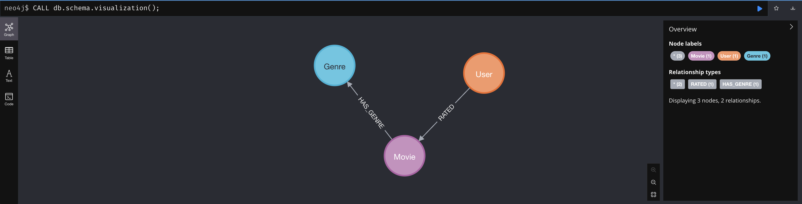
 
### 1. Які сутності стали вузлами, а які ребрами? Чому?
 
- **Вузли (User, Movie, Genre):** це самостійні об'єкти, які мають унікальний ідентифікатор або назву. Стать, вік і професію я залишила як властивості User, бо по них зручно фільтрувати, а робити з них окремі вузли немає сенсу — наприклад, до вузла «чоловіки» прив'язалося б понад 4 000 ребер. Поштовий індекс не завантажувала, бо він не потрібен для рекомендацій.
- **Ребра (RATED, HAS_GENRE):** це зв'язки між сутностями. Оцінка не існує окремо від користувача і фільму, тому логічно зробити її ребром.
### 2. Оцінка — це ребро RATED чи окремий вузол Rating?
 
Я обрала ребро `RATED` із властивостями `rating` і `timestamp`.
 
```
Ребро:  (User)-[:RATED {rating: 5}]->(Movie)
Вузол:  (User)-[:GAVE]->(Rating {rating: 5})-[:FOR]->(Movie)
```
 
Чому ребро:
 
- У нашому датасеті оцінка — це просто число і час, у неї немає текстового відгуку чи коментарів.
- Кожен користувач оцінює конкретний фільм лише один раз.
- З ребром граф виходить значно меншим (1 млн ребер замість 1 млн вузлів + 2 млн ребер), а запити коротші: шлях «користувач → фільм → інший користувач» займає 2 кроки замість 4.

Мінус ребра в тому, що до нього не можна нічого «прив'язати» іншим ребром. Тому окремий вузол Rating мав би сенс, якби до оцінки треба було додавати відгуки, лайки або історію змін оцінки.
 
### 3. Чому жанри краще зберігати як вузли Genre, а не списком у фільмі?
 
- **Швидкий пошук:** якщо жанри лежать списком у властивості фільму, для пошуку всіх трилерів базі доведеться перебирати всі 3 883 фільми. Через вузол Genre база одразу знаходить потрібний жанр за індексом і йде лише по його зв'язках.
- **Зручні обходи графа:** можна легко будувати шляхи типу User → Movie → Genre → Movie, щоб радити фільми схожих жанрів.
- **Немає дублів:** назва кожного жанру зберігається один раз, немає ризику опечаток.
Мінус такого підходу в тому, що популярні жанри на кшталт Drama мають дуже багато зв'язків і стають супервузлами (про це частина 4).
 
## Частина 2. Завантаження даних
 
Усі запити знаходяться у `queries/part2_load.cypher`.
 
Оригінальні `.dat` файли мають роздільник `::` і кодування latin-1, тому спочатку скрипт `convert.py` переводить їх у звичайний CSV в UTF-8.
 
Порядок завантаження в базу:
 
1) **Вузли (User, Movie, Genre).** Використовую `MERGE` замість `CREATE`, щоб при повторному запуску не з'являлися дублікати. У `MERGE` вказую тільки ID, а решту полів записую через `SET`. Усі числа переводжу через `toInteger()`, бо з CSV усе читається як рядки. Рік випуску дістаю з кінця назви фільму через `substring()`. Жанри розбиваю по `|` через `split()` і `UNWIND`, а `WITH DISTINCT` прибирає повтори, щоб створити рівно 18 вузлів.
2) **Індекси та CONSTRAINT.** Створюю їх до завантаження ребер. Щоб створити мільйон зв'язків RATED, базі треба мільйон разів знайти потрібного користувача і фільм — з індексами це працює майже миттєво. Обмеження `IS UNIQUE` одночасно створює індекс і захищає від дублів. Через `SHOW INDEXES` перевіряю, що всі індекси готові (`ONLINE`).
3) **Ребра.**
   - `HAS_GENRE` завантажується звичайним запитом, бо зв'язків там усього 6 408.
   - `RATED` завантажую через `apoc.periodic.iterate` батчами по 10 000 рядків (`batchSize: 10000`), щоб не робити одну величезну транзакцію, яка може впасти через нестачу пам'яті. Параметр `parallel: false` потрібен, щоб паралельні потоки не намагалися одночасно змінювати один і той самий фільм чи користувача.
  
Оцінки завантажились за 17 секунд, 101 батч, без жодної помилки (`failedOperations = 0`):
 
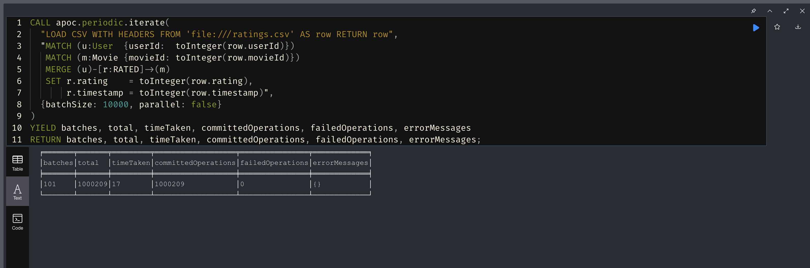
 
### Перевірка результату
 
Після завантаження перевірила кількість вузлів і ребер — усе збіглося з описом датасету:
 
- User: 6 040
- Movie: 3 883
- Genre: 18
- RATED: 1 000 209
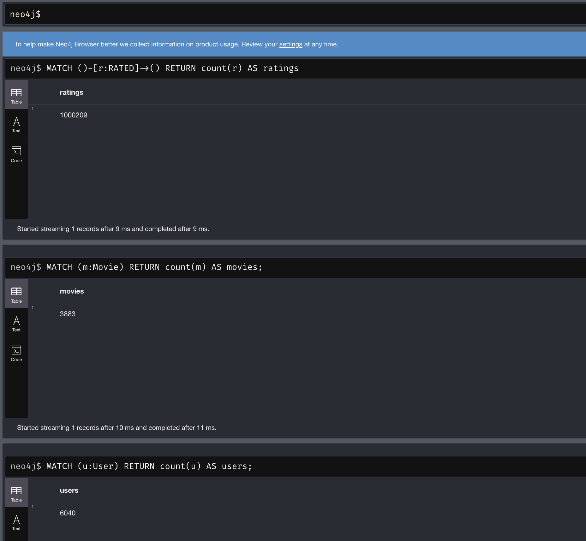
 
Приклад графа для користувача з userId = 1:
 
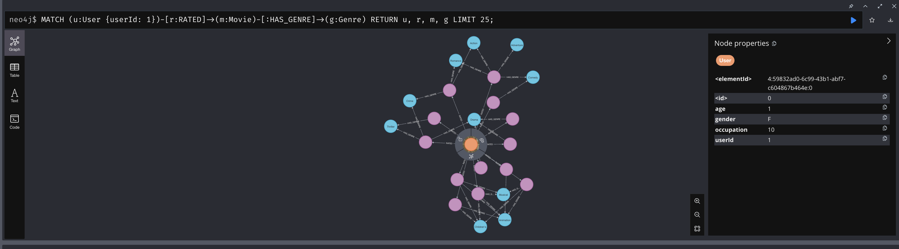
 
## Частина 3. Cypher-запити
 
Усі запити лежать у файлі [`queries/part3.cypher`](queries/part3.cypher).
 
- **Запит 1 (трилери з рейтингом > 4.0):** починаю з вузла жанру Thriller, переходжу до фільмів і оцінок, рахую середнє `avg()` та кількість оцінок `count()`. Фільтрую `WHERE avgRating > 4.0` уже після `WITH` (як `HAVING` у SQL). Кількість оцінок виводжу, щоб було видно, що середнє пораховане не з 1–2 оцінок. На перших місцях — The Usual Suspects та A Close Shave (по 4.52).
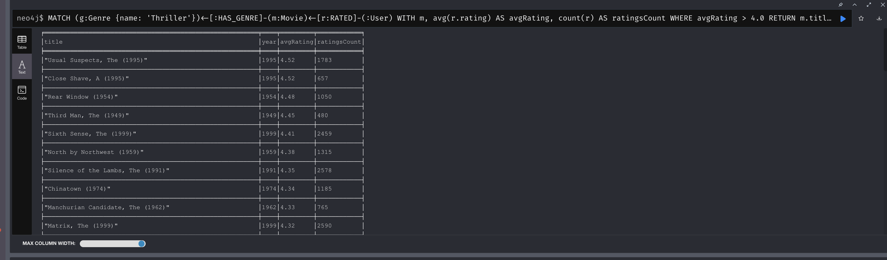
 
- **Запит 2 (користувачі, які поставили 5 понад 50 фільмам):** спочатку відбираю лише ребра з `r.rating = 5`, потім групую по користувачу і залишаю тих, у кого таких оцінок більше 50. Лідирує користувач 4277 (571 п'ятірка).
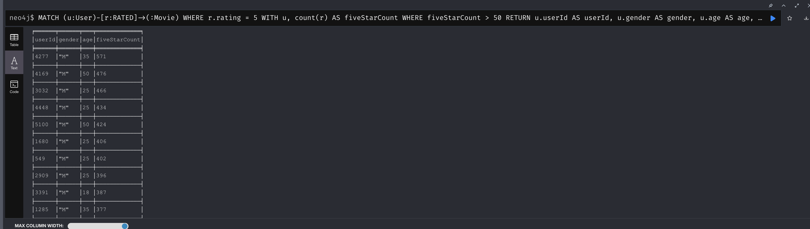
 
- **Запит 3 (спільні улюблені фільми користувачів 1 і 2):** шукаю шаблон `(u1)-[r1]->(m)<-[r2]-(u2)`, тобто обидва користувачі пов'язані з одним і тим самим фільмом, і обидві оцінки >= 4. Вийшло 6 фільмів, серед яких Awakenings, Saving Private Ryan та To Kill a Mockingbird.
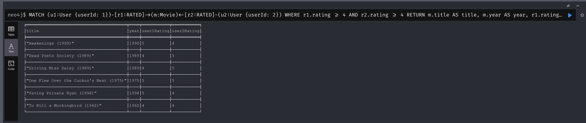
 
- **Запит 4 (жанри зі стабільно високими оцінками):** крім середньої оцінки і кількості, порахувала стандартне відхилення `stDev()` (чим менше, тим однаковіші оцінки ставлять люди) та відсоток оцінок 4–5. Найвищий і найстабільніший рейтинг у Film-Noir (середнє 4.08, 76.3% високих оцінок), хоча оцінок там небагато (18 261).
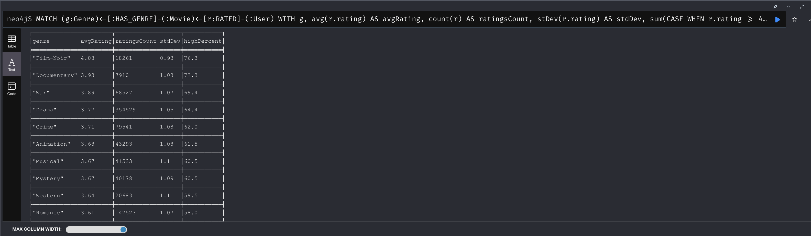
 
- **Запит 5 (рекомендації для користувача 1):** шукаю інших користувачів, які теж оцінили на 4–5 ті самі фільми, що й userId = 1. Беру топ-50 найбільш схожих людей за кількістю збігів (`ORDER BY commonLiked DESC LIMIT 50`), дивлюсь інші їхні улюблені фільми і прибираю вже переглянуті через `NOT EXISTS`. На першому місці вийшов The Shawshank Redemption (його рекомендують 47 із 50 схожих користувачів).
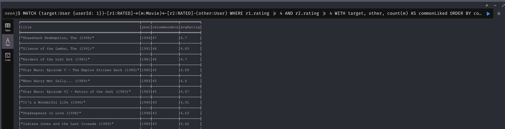
 
- **Запит 6 (найкоротший шлях між користувачами 1 і 2):** використовую `shortestPath((u1)-[:RATED*..10]-(u2))` без напрямку стрілок, щоб іти від користувача до фільму і від фільму до наступного користувача. `*..10` обмежує довжину шляху, щоб пошук не тривав вічно. Для користувачів 1 і 2 шлях має довжину 2 через спільний фільм Awakenings (1990).
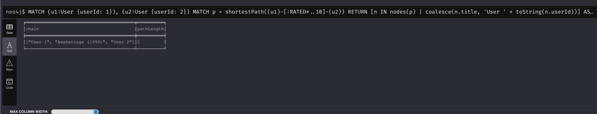
 
### Питання про довжину шляху
 
**1. Що означає довжина шляху?**
 
Довжина шляху — це кількість ребер RATED між двома користувачами. Шлях завжди чергується (User — Movie — User), тому між двома користувачами його довжина завжди парна. Чим коротший шлях, тим ближчі користувачі.
 
**2. Шлях довжини 2**
 
`User 1 → Фільм ← User 2` — обидва користувачі оцінили один і той самий фільм. Це найближчий зв'язок. Але оцінки можуть бути різні: один міг поставити 5, а інший 1.
 
**3. Шлях довжини 4 і 6**
 
- **Довжина 4** (`User 1 → Фільм A ← User X → Фільм B ← User 2`) — у користувачів немає спільних фільмів, але є «посередник» User X, який дивився один фільм з першим і інший фільм з другим. Це як «друг друга», зв'язок уже слабший.
- **Довжина 6** — між ними вже двоє проміжних користувачів, «друг друга друга». Такий зв'язок дуже слабкий і для рекомендацій майже нічого не дає.

У нашому датасеті кожен оцінив мінімум 20 фільмів, а популярні блокбастери оцінили тисячі людей. Тому більшість користувачів поєднані шляхами довжини 2 або 4.
 
## Частина 4. Супервузли
 
Запити знаходяться у `queries/part4_supernodes.cypher`.
 
Супервузол — це вузол, у якого набагато більше зв'язків, ніж у звичайних вузлів.
 
### Крок 1. Вузли з найбільшою кількістю ребер
 
```cypher
MATCH (n)
RETURN labels(n)[0] AS label,
       coalesce(n.title, n.name, 'User ' + toString(n.userId)) AS node,
       COUNT { (n)--() } AS degree
ORDER BY degree DESC
LIMIT 20;
```
 
Беру всі вузли (`MATCH (n)` без типу), для кожного рахую кількість ребер `COUNT { (n)--() }` і сортую від більшого. `coalesce` показує зрозумілу назву: у фільму `title`, у жанру `name`, у користувача номер.
 
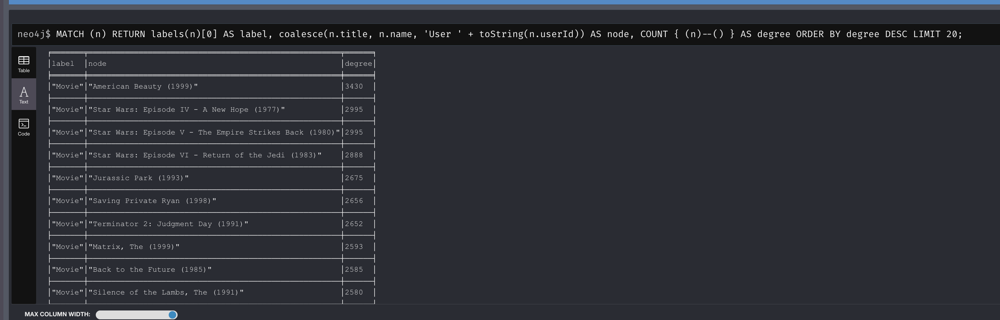
 
Уся верхівка — популярні фільми: American Beauty (3 430 зв'язків), Star Wars IV і V (по 2 995), Star Wars VI (2 888), Jurassic Park (2 675).
 
Щоб зрозуміти, чи ці числа справді «аномальні», я додала ще три запити.
 
### Крок 2. Скільки зв'язків «зазвичай»
 
Для кожного типу вузлів порахувала мінімум, середнє, медіану (значення посередині) і максимум зв'язків.
 
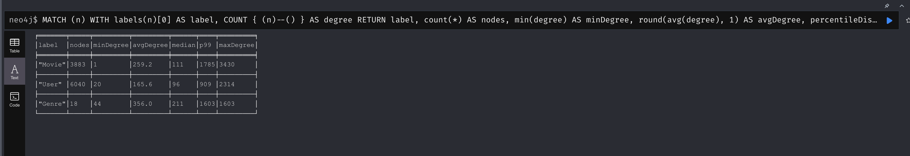
 
| Тип | Медіана | Максимум |
|---|---|---|
| Movie | 111 | 3 430 |
| User | 96 | 2 314 |
| Genre | 211 | 1 603 |
 
У звичайного фільму 111 зв'язків, а в American Beauty — у 31 раз більше.
 
### Крок 3. Чи є жанри супервузлами?
 
Для кожного жанру порахувала, скільки в нього фільмів і скільки оцінок мають ці фільми.
 
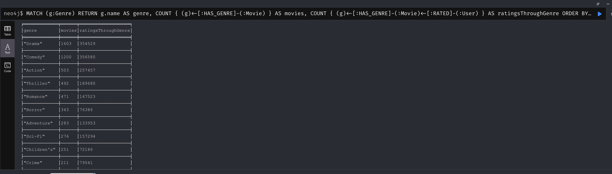
 
Drama пов'язана з 1 603 фільмами (41% усіх фільмів), а через них — з 354 529 оцінками. У Film-Noir лише 44 фільми. Тобто так, великі жанри теж супервузли.
 
### Крок 4. Порівняння через PROFILE
 
Запустила однаковий запит для Drama і Film-Noir з `PROFILE`, який показує, скільки роботи зробила база (`db hits`).
 
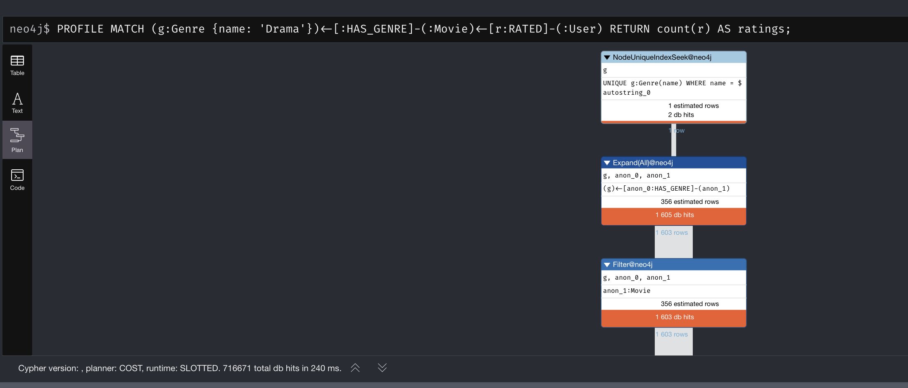
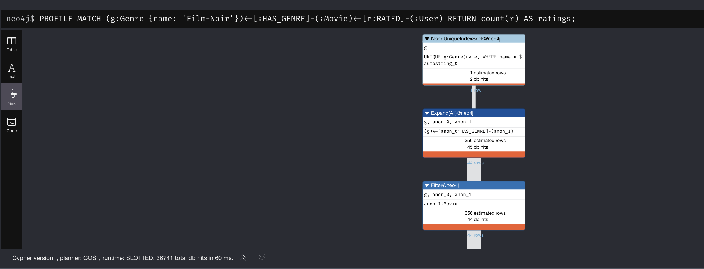
 
| | Drama | Film-Noir |
|---|---|---|
| Пошук жанру за індексом | 2 db hits | 2 db hits |
| Усього db hits | 716 671 | 36 741 |
| Час | 240 мс | 60 мс |
 
### Питання
 
**1. Які вузли виявилися супервузлами? Скільки у них зв'язків?**
 
- Популярні фільми: найбільше зв'язків у American Beauty (1999) — 3 430 (при медіані по всіх фільмах лише 111), далі Star Wars IV та V — по 2 995, Star Wars VI — 2 888, Jurassic Park — 2 675.
- Активні користувачі: максимум 2 314 зв'язків (при медіані 96).
- Великі жанри: у Drama 1 603 зв'язки з фільмами (41% усіх фільмів бази), а через них можна вийти на 354 529 оцінок. У Comedy — 1 200 фільмів.

**2. Чому запит через супервузол повільніший, навіть з тими самими індексами?**
 
Індекс допомагає тільки знайти перший вузол. Це видно в PROFILE: пошук жанру за індексом займає 2 db hits і для Drama, і для Film-Noir.
 
Але далі індекс уже не працює: базі доводиться пройти всі ребра цього вузла. Для Drama це 1 603 фільми і 354 529 оцінок (716 671 db hits, 240 мс), а для Film-Noir — лише 44 фільми і 18 261 оцінка (36 741 db hits, 60 мс). Тобто запит через супервузол робить майже у 20 разів більше операцій. Крім того, при записі багато транзакцій можуть чекати одна одну, бо всі змінюють той самий популярний вузол.
 
**3. Яку стратегію я б застосувала?**
 
Так, великі жанри тут теж супервузли. Щоб вони не гальмували запити, можна:
 
- **Починати обхід з «маленького» боку.** Якщо треба знайти драми, які дивився конкретний користувач, краще спочатку знайти його фільми (User → Movie), а вже потім перевіряти в них жанр Drama, а не йти від Drama по всіх 1 603 фільмах.
- **Зробити жанри лейблами фільму** (наприклад, `:Movie:Drama`). Жанрів усього 18 і вони не змінюються, тому Neo4j зможе знаходити фільми за лейблом без проходу через один спільний вузол.
- **Розбити великі жанри на менші частини** (наприклад, Drama 90-х, Drama 80-х), щоб на одному вузлі було менше ребер.
## Частина 5. GDS (необов'язково)
 
Додаткова частина не виконувалась.
 
## Частина 6. Аналіз і висновки
 
Для порівняння я уявляю ці дані в звичайній SQL-базі з таблицями `users`, `movies`, `genres`, `movie_genres` (який фільм якого жанру) і `ratings` (user_id, movie_id, rating — 1 000 209 рядків).
 
### 1. Граф vs SQL
 
Найскладніше в SQL було б написати **запит 6 (найкоротший шлях)**. У Cypher це одна функція `shortestPath`. У SQL кожен крок по графу — це ще один `JOIN` таблиці `ratings` самої з собою, а скільки буде кроків, заздалегідь невідомо. Тому довелося б писати рекурсивний запит:
 
```sql
WITH RECURSIVE bfs(user_id, depth, path) AS (
    SELECT 1, 0, ARRAY[1]
  UNION ALL
    SELECT r2.user_id, b.depth + 1, b.path || r2.user_id
    FROM bfs b
    JOIN ratings r1 ON r1.user_id  = b.user_id     -- фільми користувача
    JOIN ratings r2 ON r2.movie_id = r1.movie_id   -- хто ще їх оцінив
    WHERE r2.user_id <> ALL(b.path)                -- не ходити по колу
      AND b.depth < 5
)
SELECT path, depth * 2 AS path_length
FROM bfs
WHERE user_id = 2
ORDER BY depth
LIMIT 1;
```
 
Він набагато довший і на практиці дуже повільний: SQL будує всі можливі шляхи, а не зупиняється на першому знайденому. Через популярні фільми з тисячами оцінок рядків стає мільйони. Neo4j же зупиняється, щойно знайшов шлях.
 
**Запит 5 (рекомендації)** в SQL написати можна, але там таблицю `ratings` довелося б з'єднувати саму з собою кілька разів, плюс підзапит для «ще не дивився». У Cypher це просто прогулянка по графу: я → фільм → схожа людина → її фільм.
 
А от **запит 3** (спільні фільми двох людей) у SQL такий самий простий — один `JOIN`. Тобто граф виграє, коли кроків по зв'язках багато або їхня кількість невідома.
 
### 2. Де граф програє?
 
Граф програє там, де треба переглянути **всі** дані і порахувати підсумок.
 
- **Агрегація по всіх даних.** Запит 4 (статистика жанрів) проходить по мільйону оцінок по одній, переходячи від вузла до вузла. SQL просто читає таблицю підряд і групує, це швидше. А запит 2 у SQL взагалі робиться по одній таблиці без жодного `JOIN`:
```sql
SELECT user_id, COUNT(*) AS five_star_count
FROM ratings
WHERE rating = 5
GROUP BY user_id
HAVING COUNT(*) > 50;
```
 
- **Звіти.** Наприклад, середня оцінка за віковими групами або кількість оцінок по місяцях — це звичайні таблиці з групуванням, SQL для цього зручніший.
- **Експорт даних.** Excel, Power BI та інші програми працюють з таблицями і SQL, а з графа дані спочатку треба перетворити на таблицю.
- **Завантаження.** Мені довелося завантажувати оцінки батчами через APOC, а в SQL-базу мільйон рядків завантажується однією командою.
### 3. Покращення схеми
 
- **Запит 1 (трилери з рейтингом > 4.0).** Зараз запит щоразу проходить по всіх оцінках трилерів — майже 190 тисяч ребер. Можна один раз порахувати середню оцінку і записати її у фільм як властивість:
```cypher
MATCH (m:Movie)<-[r:RATED]-()
WITH m, avg(r.rating) AS avgR, count(r) AS cnt
SET m.avgRating = avgR, m.ratingsCount = cnt;
```
 
Тоді запит 1 буде читати лише 492 трилери (`WHERE m.avgRating > 4.0`), а не 190 тисяч оцінок. Мінус: після нових оцінок середнє треба перераховувати.
 
- **Запит 2 (понад 50 п'ятірок).** Зараз запит перебирає всі мільйон ребер RATED. Можна створити індекс на оцінку в ребрі, щоб база одразу знаходила п'ятірки:
```cypher
CREATE INDEX rated_rating IF NOT EXISTS
FOR ()-[r:RATED]-() ON (r.rating);
```
 
- **Запит 5 (рекомендації).** Запит тричі перевіряє `rating >= 4`. Якщо для оцінок 4–5 додатково створити окреме ребро `(:User)-[:LIKED]->(:Movie)`, запит ходитиме тільки по потрібних ребрах і не перевірятиме оцінку кожного.
### Висновок
 
Граф виявився дуже зручним для рекомендацій: знайти схожих людей, порадити фільм, знайти зв'язок між користувачами. Такі запити в Cypher короткі й зрозумілі, а в SQL вони перетворюються на багато `JOIN` або рекурсію. Але я побачила і мінуси: популярні фільми і великі жанри стають супервузлами і сповільнюють запити, а для простої статистики і звітів SQL зручніший і швидший.
 
